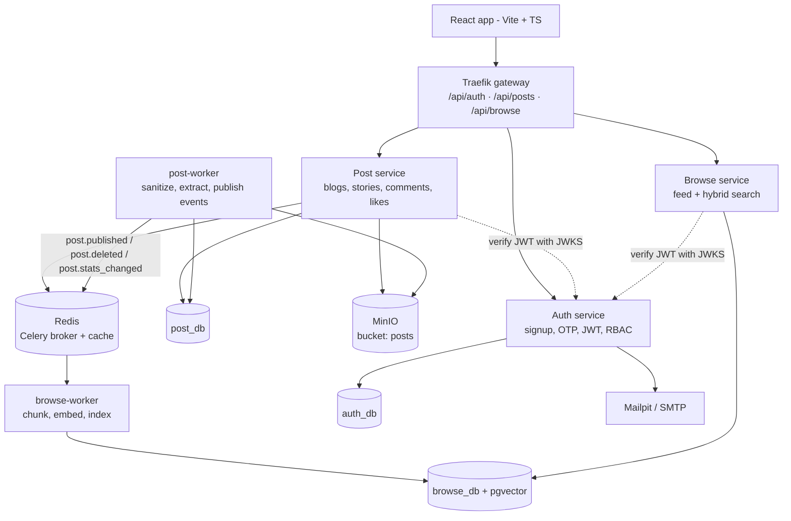
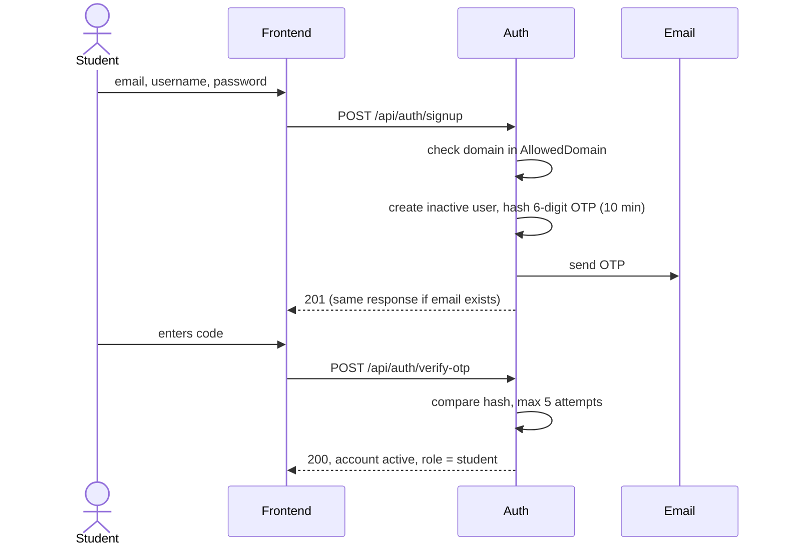
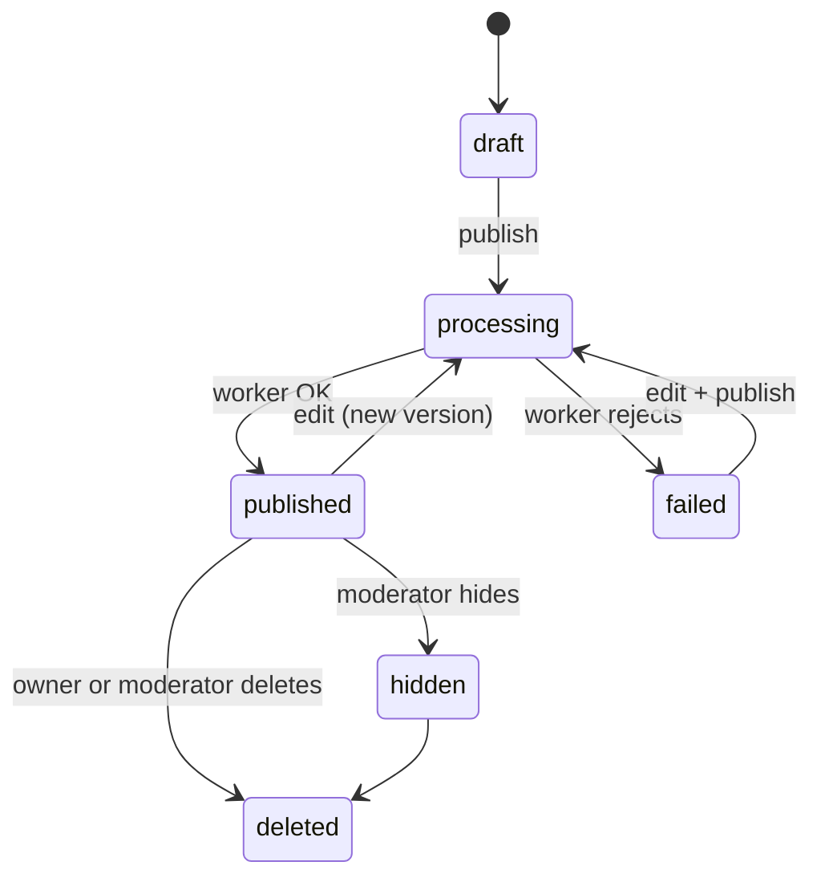
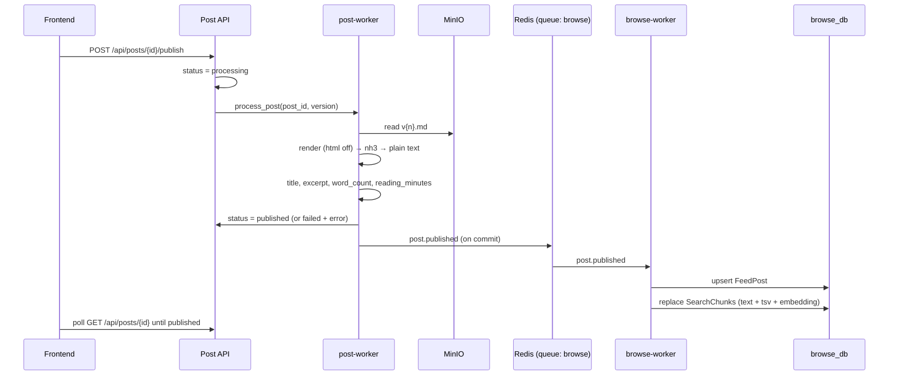
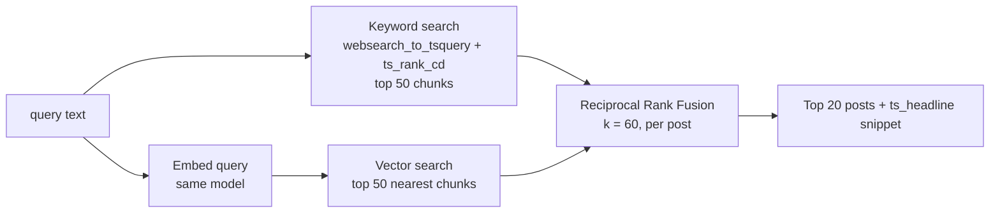

# ARCHITECTURE.md — Herald Stories (Phase 1)

How the system is built and why. Agents and developers: read this together with `AGENTS.md`.
Contracts in `contracts/` are the exact source of truth for endpoints and events; this file explains the design around them.

---

## 1. Summary

- **3 Django microservices** behind one **Traefik** gateway: `auth`, `post`, `browse`.
- **One database per service** (three Postgres databases in one container for Phase 1). No service reads another's tables.
- **Post** is the only writer of posts, comments and likes. **Browse** keeps a read copy for the feed and search, updated by **events**.
- **Markdown files live in MinIO** and are loaded only when a post is opened. Postgres holds metadata and a short excerpt.
- **Search covers the full post body**: Postgres full-text search plus pgvector embeddings, merged by Reciprocal Rank Fusion.
- **Auth** issues RS256 JWTs. Other services verify them locally with the public key.

---

## 2. System diagram



---

## 3. Services and ownership

| Service | Owns | Database / storage | Background work | Django apps |
|---|---|---|---|---|
| **auth** | Users, roles, permissions, OTP codes, refresh tokens, allowed email domains | `auth_db` | Send OTP emails | `accounts`, `rbac` |
| **post** | Blogs, stories, Markdown files, versions, comments, likes, moderation log | `post_db` + MinIO bucket `posts` | `post-worker`: sanitize Markdown, extract metadata, send events | `posts`, `interactions` |
| **browse** | Feed read model, search index (text + vectors) | `browse_db` (pgvector) | `browse-worker`: consume events, chunk, embed, index | `feed`, `search` |

Workers are Celery processes from the same codebase and image as their service. They are not separate microservices.

---

## 4. Tech stack

| Layer | Choice |
|---|---|
| Frontend | React, Vite, TypeScript, React Router, TanStack Query, Tailwind, react-markdown + remark-gfm + rehype-sanitize |
| Gateway | Traefik v3 (Docker provider; Let's Encrypt in production) |
| Services | Python 3.12, Django 5, Django REST Framework, drf-spectacular |
| Auth | djangorestframework-simplejwt (RS256), Argon2 password hashing |
| Async | Celery + Redis |
| Storage | MinIO (S3-compatible) via boto3 |
| Database | Postgres 16 with pgvector (`pgvector/pgvector:pg16`) |
| Markdown | markdown-it-py (`html=False`) + nh3 on the server; python-frontmatter for import |
| Search | Postgres full-text (`tsvector`, GIN) + pgvector (HNSW, cosine); sentence-transformers (model chosen in ADR 001) |
| Dev email | Mailpit |
| CI/CD | GitHub Actions, GitHub Container Registry, Docker Compose on a VPS |

---

## 5. Authentication and RBAC

### Sign-up and verification



### Tokens

- `POST /login` returns an **access token** (15 min) in the body and sets a **refresh token** (7 days) as an `httpOnly`, `Secure`, `SameSite=Lax` cookie on path `/api/auth`.
- Refresh tokens rotate on every use and are blacklisted on logout, password reset, suspension and ban.
- Access token claims: `sub` (user UUID), `username`, `roles`, `perms`, `iat`, `exp`, `iss` (`herald-auth`).
- Auth signs with its **private key**. Post and browse fetch the **public key** once from `GET /api/auth/.well-known/jwks.json`, cache it for 10 minutes, and verify tokens locally.
- Known trade-off: role changes and bans take effect when the current access token expires (max 15 min). Refresh fails immediately.

### Roles and permissions

Services check permission codes, never role names.

| Action | Permission | student | moderator | admin |
|---|---|:-:|:-:|:-:|
| Read feed, posts, search | `content.read` | ✓ | ✓ | ✓ |
| Create post or story, comment, like | `content.write` | ✓ | ✓ | ✓ |
| Edit or delete own post or comment | `content.edit_own` | ✓ | ✓ | ✓ |
| Hide or delete anyone's post or comment | `post.delete_any` | | ✓ | ✓ |
| Suspend a user (max 30 days) | `user.suspend` | | ✓ | ✓ |
| Ban, assign roles, manage allowed domains | `admin.manage` | | | ✓ |

All pages require login (college-only platform).

---

## 6. Posts, Markdown and storage

### Post types

| Type | Content | Limits |
|---|---|---|
| `blog` | Long Markdown with title, optional cover URL, up to 5 tags | Title ≤ 200 chars, file ≤ 1 MB |
| `story` | Short Markdown, title optional | ≤ 2,000 characters |

### Lifecycle



### Storage rules

- MinIO key: `posts/{post_id}/v{version}.md`. Each edit writes a new version; `Post.current_version` points to the live one.
- `post_db` stores only metadata: title, type, tags, author, status, excerpt (300 chars), word count, reading time, counts.
- Feed and search show the excerpt. The full file is read **only** by `GET /api/posts/{id}/content`, cached in Redis for 10 minutes (key includes the version).
- Imported `.md` files may start with YAML front matter (`title`, `tags`, `cover`). Form values override front matter.

### Markdown safety (two layers, both required)

1. **Server** (`post-worker`): markdown-it-py with `html=False` → nh3 allowlist → only `http`, `https`, `mailto` links.
2. **Client**: `<Markdown>` component with react-markdown + rehype-sanitize, no `rehype-raw`.

---

## 7. Background pipeline and events

### Publish flow



### Events (`contracts/events.md` is the exact spec)

| Event | Sent when | Payload |
|---|---|---|
| `post.published` | Post published or edited | `post_id, version, type, title, tags, author_id, author_username, excerpt, plain_text, reading_minutes, published_at` |
| `post.deleted` | Post deleted or hidden | `post_id` |
| `post.stats_changed` | Like/unlike, comment added/deleted | `post_id, like_count, comment_count` |

Rules:

- Sent with `send_task("<event name>", kwargs=..., queue="browse")` inside `transaction.on_commit`.
- Consumers are idempotent; a `post.published` with an older `version` is ignored.
- Retries: 3 with exponential backoff, then logged as failed.
- Usernames are immutable in Phase 1, so browse can safely keep a copy.

---

## 8. Feed

- Read from `browse_db.FeedPost` only.
- **New**: `published_at DESC, post_id DESC`.
- **Hot**: stored `hot_score`, recomputed only on `post.stats_changed`:

```
hot = log10(max(likes + 2 * comments, 1)) + published_at_epoch_seconds / 45000
```

The time part never changes after publishing, so no scheduled job is needed.

- Cursor pagination: cursor = base64 of `(sort_value, post_id)`, 20 items, `next_cursor = null` at the end.
- Filters: `type`, `tag`.
- Liked state: the frontend calls `GET /api/posts/likes?ids=…` for the visible posts (browse doesn't know who liked what).

---

## 9. Search (full post body)

### Index

- `SearchDoc`: one row per post; `title_tsv` (title weight A, tags weight B); GIN index.
- `SearchChunk`: plain text split into ~200-word chunks with 40-word overlap, breaking at headings/paragraphs. Each chunk has `text`, `tsv` (GIN) and `embedding vector(384)` (HNSW, cosine).
- Text search config and embedding model are set in `docs/decisions/001-embedding-model.md`:
  - English only → `all-MiniLM-L6-v2` + `english` config
  - Nepali or mixed → `paraphrase-multilingual-MiniLM-L12-v2` + `simple` config

### Query



- RRF score per post = Σ over both lists of `1 / (60 + rank)` of its best chunk.
- Title matches get extra weight.
- Snippet comes from `ts_headline` on the best chunk, with safe markers the frontend splits on (never raw HTML).
- `?mode=keyword|hybrid` (default `hybrid`). If vector search (card #47) misses the cut line, the API runs `keyword` only.
- Target: p95 < 300 ms on 10,000 posts.

---

## 10. Data models

All primary keys are UUIDs; all tables have `created_at`. Cross-service references (`author_id`, `user_id`) are plain UUIDs, never foreign keys.

### auth_db

| Model | Key fields |
|---|---|
| User | id, email (unique, lowercase), username (unique, immutable), display_name, password (Argon2), is_active, is_verified, suspended_until |
| Role | name: student, moderator, admin |
| Permission | code |
| RolePermission | role_id, permission_id |
| UserRole | user_id, role_id |
| AllowedDomain | domain, is_active |
| EmailOTP | user_id, code_hash, purpose (verify, reset), expires_at, attempts, used_at |
| Token blacklist | simplejwt tables |

### post_db

| Model | Key fields |
|---|---|
| Post | id, author_id, author_username, type, title, tags[], cover_url, status, current_version, excerpt, word_count, reading_minutes, like_count, comment_count, error_message, published_at, updated_at |
| PostVersion | post_id, version, storage_key, size_bytes |
| Comment | id, post_id, author_id, author_username, parent_id, depth (max 5), body (≤ 5,000), is_deleted, edited_at |
| Like | user_id, post_id — unique together |
| ModerationAction | actor_id, target_type, target_id, action, reason |

### browse_db

| Model | Key fields | Indexes |
|---|---|---|
| FeedPost | post_id, version, type, title, excerpt, tags, author_id, author_username, reading_minutes, like_count, comment_count, published_at, hot_score | (published_at, post_id), (hot_score, post_id), GIN(tags) |
| SearchDoc | post_id, title_tsv | GIN(title_tsv) |
| SearchChunk | post_id, chunk_index, text, tsv, embedding vector(384) | GIN(tsv), HNSW(embedding) |

---

## 11. API surface

Full request/response schemas: `contracts/*.yaml`.

| Service | Endpoints |
|---|---|
| auth `/api/auth` | `signup`, `verify-otp`, `resend-otp`, `login`, `token/refresh`, `logout`, `password/reset-request`, `password/reset-confirm`, `me`, `.well-known/jwks.json`, `admin/domains`, `admin/users`, `admin/users/{id}/roles`, `admin/users/{id}/suspend` |
| post `/api/posts` | `/` (create), `/{id}` (get, patch, delete), `/{id}/publish`, `/{id}/hide`, `/{id}/content`, `/mine`, `/{id}/comments`, `/comments/{id}`, `/{id}/like`, `/likes?ids=`, `/moderation/log` |
| browse `/api/browse` | `/feed`, `/search`, `/tags`, `/users/{username}/posts` |

Every service also has `GET /health` and `GET /api/<service>/schema/`.

---

## 12. Infrastructure

### Local (docker compose)

| Container | Port (host) | Notes |
|---|---|---|
| traefik | 80, 8080 (dashboard) | Single origin `http://localhost` |
| frontend | via Traefik `/` | Vite dev server |
| auth / post / browse | via Traefik `/api/...` | Django dev servers |
| post-worker, browse-worker | — | Celery |
| postgres | 5432 | `auth_db`, `post_db`, `browse_db`; one user per DB |
| redis | 6379 | Celery broker + content cache |
| minio | 9000 (API), 9001 (console) | Private bucket `posts` |
| mailpit | 1025 (SMTP), 8025 (UI) | Catches all dev email |

### Gateway rules

- Body limit: 2 MB on `/api/posts`, 64 KB elsewhere.
- Rate limit on `/api/auth/login` and `/api/auth/signup`.
- Security headers: `X-Content-Type-Options: nosniff`, `X-Frame-Options: DENY`, `Referrer-Policy: same-origin`.
- One origin for frontend and APIs, so CORS stays closed.

### Production

- One Linux VPS (≥ 4 GB RAM, 2 vCPU), Docker Compose (`infra/docker-compose.prod.yml`), Traefik + Let's Encrypt.
- Images built in CI and pushed to GitHub Container Registry; merge to `main` deploys over SSH and runs migrations.
- Secrets only in the server's `.env`. Production JWT keys, DB and MinIO passwords differ from dev.
- Nightly `pg_dump` of all three databases, kept 7 days.

### Key environment variables (see `.env.example`)

`DATABASE_URL`, `REDIS_URL`, `CELERY_BROKER_URL`, `MINIO_ENDPOINT`, `MINIO_ACCESS_KEY`, `MINIO_SECRET_KEY`, `MINIO_BUCKET`, `JWT_PRIVATE_KEY_PATH` (auth only), `JWT_JWKS_URL` (post, browse), `JWT_ISSUER`, `EMAIL_HOST`, `EMAIL_PORT`, `EMAIL_HOST_USER`, `EMAIL_HOST_PASSWORD`, `DEFAULT_FROM_EMAIL`, `ALLOWED_HOSTS`, `EMBEDDING_MODEL`, `SEARCH_TEXT_CONFIG`.

---

## 13. Key decisions

| # | Decision | Why |
|---|---|---|
| D1 | Markdown in MinIO, loaded only when a post is opened | Light feed, small database |
| D2 | Search over full body; Postgres FTS + pgvector in the same Postgres | Exact words and meaning; no extra search server |
| D3 | Build email OTP ourselves (no SSO in Phase 1) | Learning goal; SSO can come later |
| D4 | Keep Markdown import; sanitize on server and client | Raw Markdown can carry scripts |
| D5 | 3 services: auth, post, browse | Enough to learn microservices without too many moving parts |
| D6 | Post is the only writer; browse is a read model fed by events | Clear ownership; feed/search can scale separately |
| D7 | RS256 JWT verified locally in each service | No call to auth on every request |
| D8 | Contracts first, frozen before Build stage | Five people vibe coding need one shared definition |

New decisions go in `docs/decisions/NNN-title.md` (context, decision, consequences — half a page).

---

## 14. Out of scope for Phase 1

Communities (subreddit-style), downvotes, notifications, direct messages, Google/Microsoft sign-in, image upload to MinIO, comment likes, typo-tolerant search, recommendation feed, Kubernetes.
